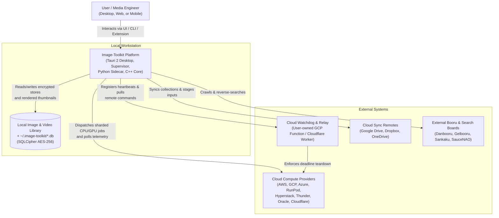
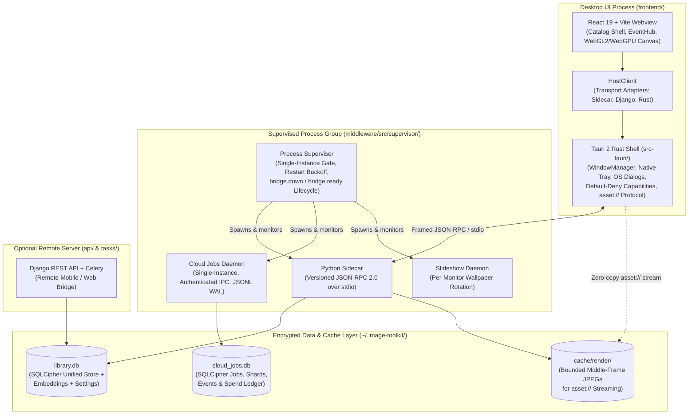
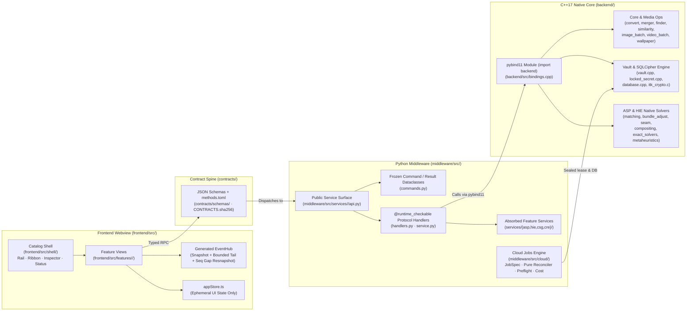

# Image-Toolkit Architecture Reference

**Image-Toolkit** is a modular, multi-language desktop and cloud media engineering platform. Its architecture separates the presentation shell (**React 19 + Tauri 2**) from the domain service layer (**Python `middleware/`**) and the performance/cryptography core (**C++17 `backend/`** via `pybind11`).

> For the 13-stage Anime Stitch Pipeline (ASP) algorithmic reference and stage flowcharts, see [ASP_ARCHITECTURE.md](ASP_ARCHITECTURE.md).
> For the locked architectural decisions and rationale, see [Architecture Decision Records (ADRs)](adr/index.md).

---

## 1. C4 Level 1 — System Context

At the system context level, Image-Toolkit runs locally on the user's workstation while orchestrating optional remote compute providers, external media boards, and cloud storage remotes.

---

## 2. C4 Level 2 — Containers & Process Topology

A lightweight **Supervisor** (`middleware/src/supervisor/`) runs outside the webview and manages the **Python Sidecar**, **Cloud Jobs Daemon**, and **Slideshow Daemon** as sibling OS processes. Closing every GUI window does not interrupt durable background work, and a sidecar restart does not drop daemon credential leases.

### Process Invariants

| Invariant | Enforcement Mechanism |
|---|---|
| **No business logic in Tauri Rust** | `frontend/src-tauri/` handles only windowing, tray, native dialogs, drag-and-drop, and `asset://` streaming. Domain logic lives in `middleware/src/services/` and `backend/`. |
| **Stdout is protocol-only** | Sidecar `stdout` carries exclusively framed JSON-RPC messages; `stderr` carries redacted diagnostics. |
| **Vault keys stay in C++** | `backend::vault` holds master keys and database keys in `mlock`-pinned memory (`LockedSecret`). The webview receives only an opaque session handle; daemons receive **sealed per-store leases** (`backend::vault::unseal_lease`). |
| **Zero-copy media transport** | Large images are never base64-encoded over stdio. The C++ thumbnail service writes bounded middle-frame stills to `~/.image-toolkit/cache/render/`, and the webview streams them via `asset://` under a strict capability scope. |
| **Single encrypted database engine** | Both `library.db` and `cloud_jobs.db` use SQLCipher via `backend.database.Database`. PostgreSQL/pgvector is retired. |

---

## 3. C4 Level 3 — Service & Core Components

Every feature vertical follows a strict layered architecture with automated boundary enforcement in both Python (`import-linter`) and TypeScript (`eslint-plugin-boundaries`).

---

## 4. Repository Module Map & Boundary Rules

| Directory | Package / Target | Role | Boundary Contract |
|---|---|---|---|
| `contracts/` | `contracts/generate.py` | Single source of truth for RPC schemas (`contracts/schemas/`), routing (`methods.toml`), generated TS/Py/Rust bindings, and `CONTRACTS.sha256`. | `python contracts/generate.py --check` fails CI on drift. |
| `backend/` | `import backend` (`.so`) | Unified CMake + pybind11 C++17 extension (including absorbed ASP and HIE C++ solvers, SQLCipher DB engine, and `libitk_crypto.so`). | Built via `just build::build-base`; tested via `just test-base-cpp`. |
| `middleware/` | `middleware.src.*` | Python orchestrator, `services/<feature>/` Command/Handler layer, `supervisor/`, `cloud/`, and ML pipelines. | Must never import `gui.*` or `PySide6` (except `middleware/src/app.py` launch shim). Sibling services under `middleware/src/services/*` are independent (`lint-imports`). |
| `frontend/` | `image-toolkit` | React 19 + TypeScript + Vite webview and `src-tauri/` Rust host. | `eslint-plugin-boundaries` forbids cross-feature and cross-tab-domain imports; `check_tauri_security.py` enforces real CSP and default-deny `asset://` scopes. |
| `gui/` | `gui.src.*` | Legacy PySide6 desktop interface (coexisting during Tauri migration). | **Frozen to reviewed bugfixes only** (`W0-20`). New UI lands exclusively in `frontend/`. |
| `migration/` | `migration/features.toml` | Capability migration ledger, route maps, parity scenarios, and bounded freeze/schema exceptions. | Validated in CI; generates `docs/migration/parity.md`. |
| `api/` & `tasks/` | Django + Celery | Remote HTTP/WebSocket bridge exposing `middleware/src/services/` to mobile and web clients. | Tasks must remain idempotent and contain zero domain logic. |
| `app/` & `extension/` | Android, iOS, WebExt | Kotlin/Compose Android app, SwiftUI iOS app, and Manifest V3 browser extension. | Consume contracts via `api/`. |
