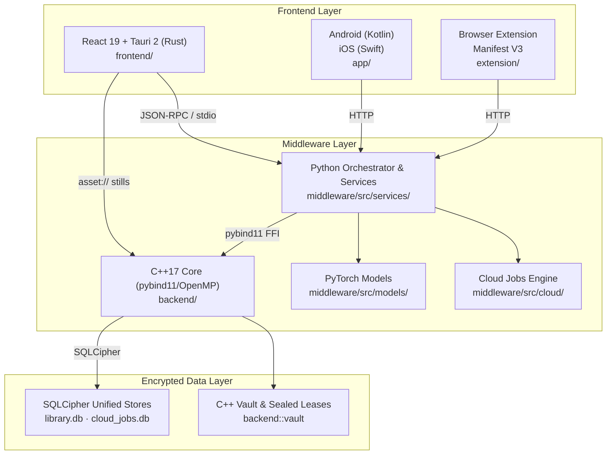

# Image-Toolkit Documentation

**Image-Toolkit** is an integrated image database and editing framework that bridges high-performance computer vision (PyTorch, OpenCV, C++/pybind11) with robust web automation (Selenium) and cross-platform accessibility.

You're already using it — this page is rendered by the [Vue documentation site](website/APP.md) (`docs/website/`), which renders every page here with instant search (⌘K), a collapsible sidebar, dark mode, and live Mermaid diagrams. Head back to the [engineering hub](website/APP.md) for the module explorer, submodule ecosystem, and roadmap/benchmark panels.

---

## What's here

| Section | Description |
|---------|-------------|
| [Quick Start](../README.md) | 5-minute setup, environment bootstrapping, CLI reference |
| [Development](DEVELOPMENT.md) | Developer onboarding, build workflow, adding a capability |
| [Architecture](ARCHITECTURE.md) | C4 system context, container, and component diagrams |
| [ASP Stitching Architecture](ASP_ARCHITECTURE.md) | 13-stage Anime Stitch Pipeline reference and stage flowcharts |
| [Architecture Decisions (ADRs)](adr/index.md) | Locked decisions from Tauri Migration and Cloud Jobs roadmaps |
| [Modules](modules/index.md) | Capability module READMEs and contract SHA-256 spine |
| [Troubleshooting](TROUBLESHOOTING.md) | PySide6 crashes, ASP errors, C++ builds, Hydra, mobile |
| [Python API](api/python/animation.md) | Auto-generated reference from Google-style docstrings |
| [C++ API](api/rust/math.md) | Math backbone: linalg, stats, distance, information, graph |
| [Benchmarks](BENCHMARKS.md) | ASP corpus, C++ Catch2, frontend math benchmarks |
| [Dependency Policy](DEPENDENCY_POLICY.md) | Version pins, upgrade cadence, security CVE SLA |
| [Documentation Standards](DOCUMENTATION_STANDARDS.md) | Docstring style, TOC rules, enforcement hooks |
| [Roadmaps](moon/ROADMAP.md) | Architecture, performance, features, GUI/UX, ASP, docs |
| [Changelog](moon/CHANGELOG.md) | All shipped features ordered by session |


---

## Project at a glance



---

## Key entry points

```bash
# Tauri web app (recommended)
npm run dev

# Python PySide6 desktop GUI
source .venv/bin/activate && python middleware/main.py

# Hydra CLI (training, embedding, ComfyUI)
python -m backend.dispatcher command=train

# ASP benchmark suite
pytest middleware/test/animation/ --skip-gpu

# Rust doc generation
cd base && cargo doc --no-deps --open
```

---

## Stack versions

| Component | Required |
|-----------|---------|
| Python | 3.11+ |
| Rust | 1.70+ |
| Node.js | 18+ |
| PostgreSQL | 14+ |
| pgvector | 0.5.0+ |
| Android SDK | API 26+ |
| iOS / Xcode | 16+ / 15+ |
